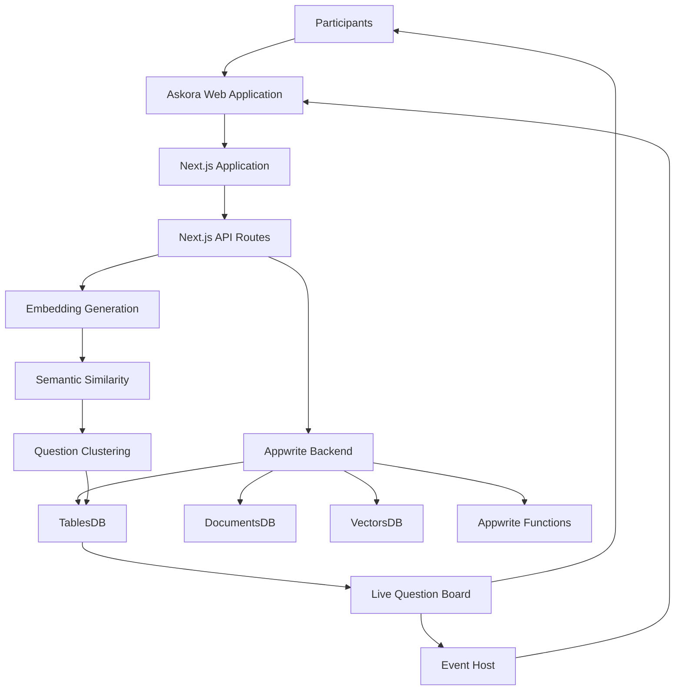

# Askora — Live Q&A That Deduplicates Itself

> Ask questions once. Let similar questions unite. Let demand decide what gets answered.

Askora is a real-time Q&A platform designed for live events, classrooms, hackathons, workshops, and interactive sessions. Instead of allowing repetitive questions to flood a live Q&A board, Askora intelligently groups semantically similar questions into clusters and prioritizes them based on audience demand.

🌐 **Live Demo:** [https://askora-nu.vercel.app](https://askora-nu.vercel.app)

---

## 📸 Screenshots

\<!-- Replace these paths with actual screenshots saved inside the screenshots/ folder -->

### Host Dashboard


### Live Question Board


### Participant Question Submission


### Question Clustering


---

## 🚨 Problem Statement

Ever been in a live session where dozens of people ask questions, but somehow, the same question gets asked again and again?

One person phrases it differently. Another asks almost the same thing. Meanwhile, genuinely important questions get buried under a sea of duplicates, making it harder for both the audience and the host to keep track.

In live Q&A sessions, it's not always about how many questions are asked — it's about **which questions matter the most to everyone.**

That's where **Askora** comes in! 💡

Askora brings similar questions together, recognizes what people are really asking, and lets audience demand help determine what deserves attention. Instead of drowning in repeated questions, hosts get a clearer picture of what the audience actually wants to know.


---

## 💡 Solution

Askora transforms individual audience questions into dynamically organized question clusters.

- **Semantic deduplication:** Identifies questions with similar meanings, even when worded differently.
- **Demand-based prioritization:** Uses audience engagement to help surface the most relevant questions.
- **Live Q&A:** Participants submit questions and interact with a live question board.
- **Dynamic clustering:** Similar questions are grouped together as the event progresses.
- **Host moderation:** Hosts can manage questions and control the event.
- **Answer management:** Hosts can answer and manage clustered questions.
- **Real-time experience:** Keeps the participant and host experience responsive during live sessions.

---

## 🏗️ System Architecture



### 🏗️ Architecture Overview

Askora transforms a flood of individual questions into organized, meaningful clusters. Here's how a question travels through the system:

1. **Event Participation** – Participants join an event and submit their questions through Askora's web interface.

2. **API Processing** – The question reaches the Next.js API layer, where the request is validated and the question-processing workflow begins.

3. **Concurrency Control** – Upstash Redis is used for distributed locking and coordination, helping prevent conflicting concurrent operations during question processing.

4. **Embedding Generation** – The question is converted into a numerical embedding that captures its semantic meaning.

5. **Candidate Retrieval** – The system retrieves potentially similar existing questions or clusters to identify relevant candidates for comparison.

6. **Semantic Evaluation** – The retrieved candidates are evaluated using an LLM-based judging workflow powered by Groq, with Gemini serving as a fallback where configured.

7. **Cluster Assignment** – If a semantically matching cluster is identified, the question is associated with that cluster. Otherwise, a new cluster is created.

8. **Persistence & Demand Tracking** – Questions, cluster associations, and audience interactions are stored and updated using Appwrite TablesDB.

9. **Live Board Updates** – The organized question clusters and their demand are reflected on the event board, helping participants see what the audience is asking.

10. **Host Moderation & Answers** – Hosts can manage the event's questions, moderate submissions, and respond to the audience through the dashboard.

---

## ⚙️ How Askora Works

### 1. Event creation

The host creates an event through the host dashboard.

### 2. Event participation

Participants join the event using the event link or event identifier.

### 3. Question submission

Participants submit questions through the participant interface.

### 4. Semantic processing

The submitted question is processed and represented using embeddings.

### 5. Similarity detection

The system compares the question with existing question representations to identify semantically related questions.

### 6. Question clustering

Related questions are grouped together instead of being displayed as repetitive individual entries.

### 7. Demand aggregation

Audience demand is aggregated at the cluster level to help identify questions that matter most to participants.

### 8. Live prioritization

The question board organizes clusters based on demand, helping hosts identify what to answer next.

### 9. Moderation and answering

Hosts can moderate questions, manage the board, and answer audience questions.

---

## ✨ Features

- Live event-based Q&A.
- Semantic question deduplication.
- Similar-question clustering.
- Demand-based question ranking.
- Host dashboard.
- Participant interface.
- Question moderation.
- Answer management.
- Appwrite-powered backend.
- Embedding-based similarity processing.
- Real-time updates.

---

## 🛠️ Tech Stack

| Category | Technology |
|---|---|
| Frontend Framework | Next.js |
| Programming Language | TypeScript |
| UI Styling | Tailwind CSS |
| Backend & API | Next.js API Routes |
| Backend Platform | Appwrite |
| Database | Appwrite TablesDB |
| AI & LLM Orchestration | Groq |
| LLM Fallback | Google Gemini |
| Semantic Processing | Text Embeddings & Semantic Similarity |
| Distributed Coordination & Locking | Upstash Redis |
| Locking Mechanism | Redis-based Distributed Locks |
| Deployment & Hosting | Vercel |


---

## 📂 Project Structure

```text
Askora/
├── app/
│   ├── api/
│   │   ├── clusters/
│   │   ├── embeddings/
│   │   ├── events/
│   │   ├── questions/
│   │   └── votes/
│   ├── event-board/
│   ├── host-auth/
│   ├── host-dashboard/
│   └── join/
├── eval/
├── screenshots/
├── public/
├── .env.local
├── package.json
└── README.md
```

---

## 🚀 Getting Started

### Prerequisites

- Node.js
- npm
- An Appwrite account
- An Appwrite project configured for web access

### 1. Clone the repository

```bash
git clone https://github.com/YOUR_USERNAME/Askora.git
cd Askora
```

### 2. Install dependencies

```bash
npm install
```

### 3. Configure environment variables

Create a `.env.local` file in the root directory.

```env
# Add the environment variables required by your project here
```

Populate it with the environment variables used by your Appwrite configuration and application services.

### 4. Run the development server

```bash
npm run dev
```

Open:

[http://localhost:3000](http://localhost:3000)

### 5. Build for production

```bash
npm run build
```

---

## 🌐 Deployment

Askora is deployed using Vercel.

Deployment workflow:

1. Push the source code to GitHub.
2. Connect the repository to Vercel.
3. Configure production environment variables.
4. Configure the deployed hostname in Appwrite's Web platform settings.
5. Deploy the application.
6. Verify authentication, event creation, participation, voting, and host dashboard functionality.

---

## 🔐 Security

- Environment variables are used for configuration.
- Secrets and API credentials should not be committed to the repository.
- Appwrite permissions should be configured appropriately.
- Production domains should be registered in Appwrite platform settings.

---

## 🎯 Use Cases

- Classroom Q&A sessions.
- Workshops and seminars.
- Hackathons.
- Conferences.
- Interactive webinars.
- Team meetings.
- Live presentations.

---

## 🔮 Future Improvements

- Improved clustering accuracy.
- Advanced moderation tools.
- Analytics for question trends.
- Enhanced event-level insights.
- Improved participant engagement metrics.
- Further optimization of embedding-based question matching.
